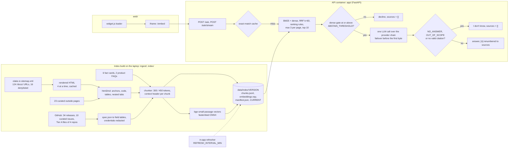

# Ask OLake

A cited docs assistant for [OLake](https://olake.io). Ask a question about OLake Go (ingestion into Apache Iceberg)
or OLake Fusion (Iceberg table maintenance) and get a short answer whose `[n]` markers point at the OLake pages,
GitHub files, releases and issues it came from. When the corpus has no answer, it says so instead of guessing.

- Public API: `POST /ask` with `{"question": "..."}` returns exactly `{"answer": "...", "sources": ["<url>", ...]}`
- The chat widget embeds in any docs site with one script tag
- Live demo: `https://HOST/` · API: `POST https://HOST/ask` · License: Apache-2.0. `HOST` is the deployment URL;
  see [WAKEUP.md](WAKEUP.md) for how to get one.

## Embed it

One line on any docs page:

```html
<script src="https://HOST/widget.js" data-api="https://HOST" async></script>
```

Where a page cannot run third-party scripts, use a plain iframe. The page's CSP then needs `HOST` in `frame-src`:

```html
<iframe src="https://HOST/embed" title="Ask OLake" width="400" height="600" style="border:0"></iframe>
```

In Docusaurus, add it to `docusaurus.config.js`; the widget follows the site's light and dark theme:

```js
scripts: [{src: 'https://HOST/widget.js', async: true, 'data-api': 'https://HOST'}],
```

Options: `data-title`, `data-position="left|right"`, `data-accent="#hex"`, `data-open="true"` and `data-timeout`.
The loader sets no cookies and no storage, and its CSS only touches `.askolake-*` elements (`web/widget.js`).

## Architecture



| Component | Paths | What it does |
|---|---|---|
| Ingestion | `ingest/` (`sitemap.py`, `fetch.py`, `html2md.py`, `docs.py`, `github.py`, `spec2md.py`, `faq.py`, `outside.py`, `config.py`) | Sitemap and denylist, polite cached fetching, Docusaurus HTML to Markdown, GitHub releases, issues and repo files (clones, compare API, contents API), spec.json field tables, the FAQ JSON-LD, outside pages. `config.py` holds the whole corpus definition |
| Index | `index/` (`chunk.py`, `sources.py`, `embed.py`, `build.py`, `refresh.py`, `manifest.py`, `validate.py`, `probe.py`, `factcheck.py`) | Structure-aware chunking, the chunk records of contract I1, passage embeddings with vector reuse, the versioned artifact with an atomic `CURRENT` swap, the incremental refresher, the validator and the BM25 probe |
| Curated corpus | `index/factcards/*.md`, `index/issues/*.md` | Fact cards written from the extracted docs, each section citing its pages; key facts of the 10 curated issues |
| Index artifact | `data/index/<version>/`, `data/index/CURRENT` | The committed index the image serves |
| API | `app/` (`main.py`, `pipeline.py`, `retrieval.py`, `llm.py`, `citations.py`, `guard.py`, `limits.py`, `index_store.py`, `refresh.py`, `prompts.py`, `embedder.py`, `config.py`, `logs.py`) | Endpoints (contract I2), retrieval and ranking rules, the off-topic gate, the provider chain, citation validation and renumbering, output guards (canary, markers), load protection, hot-swappable index snapshots, JSON logs |
| Widget | `web/` (`widget.js`, `embed.html`, `embed.js`, `embed-core.mjs`, `embed.css`, `demo/index.html`) | The loader, the iframe chat app and the demo page |
| Eval | `eval/` (`questions.md`, `questions.py`, `run.py`, `report.py`, `results/`) | The 94-row question table, the runner (deterministic checks, LLM judge, retrieval-only), the README tables, every measured result |
| Deploy | `Dockerfile`, `deploy/` (`deploy.sh`, `env.yaml`, `ngrok.sh`), `.do/app.yaml` | The image, Cloud Run (primary), DigitalOcean App Platform (fallback), an ngrok tunnel (emergency), the smoke checks |
| Checks | `tests/`, `scripts/verify.sh` | Unit tests per area, the e2e test on local ollama, the verifier's gate |

## Design choices and trade-offs

| Decision | Alternatives considered | Why |
|---|---|---|
| Hybrid BM25 + dense (RRF k=60), no reranker, top 10 chunks to the LLM | BM25 only; dense only; a cross-encoder rerank; an agentic tool loop; long-context stuffing | Exact config keys need lexical match and paraphrases need dense. On this index the hybrid gets MRR@10 0.854 and hit@10 0.988 over 82 rows (`eval/results/retrieval-baseline.json`). FlashRank TinyBERT over the fused top 20 lowered MRR@10 to 0.814 at the same hit@10 (`eval/results/retrieval-tinybert.json`). One LLM call keeps latency and cost low |
| Local embeddings: fastembed `BAAI/bge-small-en-v1.5`, ONNX on CPU | A provider's embedding API; bge-base | Works with any LLM provider, costs nothing per query, has no rate limit and is deterministic. Embedding a query takes milliseconds: `/debug/retrieve` answers in 32 ms p50 for the whole retrieval (`eval/results/retrieval-baseline.json`). The container idles at 211 MiB RSS (`eval/results/container-smoke.json`). bge-base was not better enough to pay 3.3x the embedding time (POC: hybrid MRR@10 0.745 vs 0.736, `poc/results/retrieval-canonical.json`) |
| Vectors in process (numpy) | A vector database | 2,434 chunks x 384 dims is 3.7 MB; one less service to run |
| Rendered HTML of the docs pages | Raw MDX from the docs repo | The canonical URL comes as is, and MDX components hide content on 22 of 124 pages (research.md §3.1) |
| Structure-aware chunks: 300-token target, 450 hard max, a context header `title \| product > breadcrumbs > headings [tab path]` | Fixed-size windows; 600-token chunks | Never splits a code fence or a table (oversized tables repeat their header row), never mixes two tab panels, keeps headings with their content. 600-token chunks scored lower on every POC config (`poc/results/retrieval-canonical.json`) |
| Fact cards with per-section citations | Relying on pages that never state a negative | "Does OLake support Oracle CDC?" needs a page that says no. 6 cards, each fact checked against its cited pages (`index/factcheck.py`); each section cites only the pages its facts come from |
| Canonical URLs in `sources`, deep links in the UI | Anchored URLs in `sources` | Robust matching for graders, precise navigation for people |
| Three logged abstain triggers: the off-topic gate, the model's NO_ANSWER / OUT_OF_SCOPE, no valid citation | A prompt-only "say I don't know" | Measurable and tunable. The gate alone, at the calibrated 0.6894, catches 5 of the 12 must-abstain rows with no false abstain (`eval/results/retrieval-baseline.json`); the model and citation validation do the rest |
| Outside pages (Iceberg, Amoro, Postgres, MySQL, MongoDB, Kafka, catalogs), labelled, ranked below first-party pages | No outside pages | Without them MRR@10 drops 0.854 to 0.840 and hit@1 0.780 to 0.768 (`eval/results/retrieval-no-outside.json`). The 12 must-abstain gate scores are unchanged (UNK-04 moves by 6e-08, float rounding), so the calibrated threshold is the same. Two must-answer gate scores drop: SYNC-08 0.7728 to 0.7673, SYNC-12 0.7868 to 0.7782 |
| Loader plus iframe widget | A Shadow DOM widget | Needs no host-page CORS or connect-src change, and styles are isolated |
| Exact-match cache only | A semantic cache | Two similar questions can need different answers |
| Incremental refresh on the sitemap ETag plus content hashes, and git SHAs | Full rebuilds; HTTP ETags as content signals | olake.io ETags change on every site deploy, so the ETag only decides whether to re-fetch; content hashes decide what to re-chunk and re-embed. `git ls-remote` uses no API quota. A quiet poll (sitemap 304, no repo moved) takes 1.6 s, the median of 3 runs (`eval/results/container-smoke.json`) |

## Evaluation

**Method.** `eval/run.py` follows the "Scoring method" in [eval/questions.md](eval/questions.md):

- It posts every question to `POST /ask` with `X-Request-ID: eval-<ID>` and `Cache-Control: no-cache`.
- It runs the deterministic checks:
  - **schema**: HTTP 200 and exactly `{answer, sources}`;
  - **contract**: also on 422 and 503;
  - **abstain detection**: empty sources, a don't-know pattern or the degraded answer, each recorded with an
    `abstain_kind` (the pattern differs from the plan's: see "How the abstain pattern moved" below);
  - **behaviour** by question type;
  - **lenient source match**;
  - **a prompt-leak canary**;
  - **latency**.
- An optional LLM judge scores must-mention fact coverage, the BEHAVIOR checks and contradictions.

`--retrieval-only` measures hit@k and MRR@10 through `POST /debug/retrieve`, without an LLM.

**The set.** 94 rows (types answerable 69, negative 5, false-premise 4, adversarial 4, out-of-scope 6,
unanswerable 6). They cover 12 categories, from source-config (18) to security (1). 82 rows have expected sources;
12 must abstain. Research agents wrote the rows, an adversarial verifier checked them, and the lead curated them
before any of this code existed ([docs/eval-questions.md](docs/eval-questions.md)).

**Retrieval** (no LLM; 82 rows with expected sources; `uv run python -m eval.report <file>`):

| Config | hit@1 | hit@3 | hit@5 | hit@10 | MRR@10 | File |
|---|---|---|---|---|---|---|
| Hybrid, RERANK=off (shipped) | 0.780 | 0.890 | 0.939 | 0.988 | 0.854 | `eval/results/retrieval-baseline.json` |
| Hybrid + TinyBERT@20 | 0.707 | 0.902 | 0.915 | 0.988 | 0.814 | `eval/results/retrieval-tinybert.json` |
| Hybrid, no outside tier | 0.768 | 0.878 | 0.915 | 0.988 | 0.840 | `eval/results/retrieval-no-outside.json` |

**End to end** (`eval/results/final.json`, the shipped default `PROMPT_REMINDERS=off` at `3675869`: 94 rows, one at
a time, against local `qwen3:32b`, judged by the same model; from `uv run python -m eval.report
eval/results/final.json`):

| Metric | Value |
|---|---|
| Schema valid / contract failures | 1.000 / 0 |
| Behaviour correct | 91/94 (0.968) |
| Source hit rate | 74/82 (0.902) |
| Fact coverage / BEHAVIOR pass (judge) | 0.702 / 0.95 |
| Abstain recall (12 rows) | 10/12 |
| False abstain: answerable (69) / all must-answer (82) | 0/69 / 1/82 |
| Latency p50 / p95 | 26.9 s / 64.9 s |

**Prompt levers, and why the default ships without them.** Four prompt levers were measured end to end, each on top
of the one before, against the baseline answer path and with the scorer frozen:

| Run | Commit | File | Abstain recall | False abstain (69 / 82) | Behaviour | Source hit | Facts | BEHAVIOR | Contradictions | p50 / p95 |
|---|---|---|---|---|---|---|---|---|---|---|
| Baseline: the plan's prompt, plain retry | `a184a65` | `eval/results/baseline.json` | 11/12 | 0 / 1 | 92/94 | 74/82 | 0.706 | 0.95 | 6 | 28.4 / 57.8 s |
| L1: + cite reminder and uncited retry | `56d642e` | `eval/results/lever1-cite.json` | 9/12 | 1 / 2 | 89/94 | 77/82 | 0.717 | 1.00 | 5 | 24.4 / 50.5 s |
| L2: + premise check | `fb2ff63` | `eval/results/lever2-premise.json` | 9/12 | 2 / 2 | 89/94 | 76/82 | 0.737 | 1.00 | 4 | 26.4 / 58.1 s |
| L3: + cite every supporting passage | `d474c14` | `eval/results/lever3-citeall.json` | 8/12 | 1 / 1 | 89/94 | 77/82 | 0.723 | 1.00 | 5 | 27.1 / 66.1 s |
| L4: + marker and refusal reminders (= `PROMPT_REMINDERS=on`) | `974014d` | `eval/results/lever4-markers.json` | 9/12 | 1 / 1 | 90/94 | 76/82 | 0.755 | 0.95 | 5 | 28.3 / 59.9 s |
| Final: `PROMPT_REMINDERS=off` (the default) | `3675869` | `eval/results/final.json` | 10/12 | 0 / 1 | 91/94 | 74/82 | 0.702 | 0.95 | 7 | 26.9 / 64.9 s |

- **The rule, fixed before L3 and L4 ran: targets first, then quality.** A lever set becomes the default only if it
  meets the plan's targets (checkpoint 2.2: contract failures 0, abstain recall at least 90%, which is 11/12, and
  false abstain at most 5%, which is 3/69). Only then do fact coverage and source hit decide.
- **Outcome.** No lever run reached 11/12 (the best was 9/12), so the default is the baseline answer path: the
  plan's prompt with a plain retry. The final run measures it again at the shipped commit. Against `baseline.json`,
  the same path at `a184a65`, it shows 1 row with a changed verdict (behaviour correct: UNK-02; abstained: UNK-02).
- **Recall run to run.** The final run's abstain recall is 10/12 against the baseline's 11/12, below the 90% target.
  UNK-02 answered this time (answered, 1 source), where the baseline abstained (no_valid_citation, 0 sources). The
  same decline counts as an abstain only when it carries no valid citation. On this path recall is 10 or 11 of 12
  run to run, still above every lever run (8 or 9).
- **Reproducibility.** The same answer path on the same index, run twice: 48 of 94 answers are byte-identical to the
  baseline's and 83 of 94 source lists match; local generation is not deterministic, so single-row flips like the
  above are run-to-run noise.
- **`PROMPT_REMINDERS=on`** turns on all four levers, as measured in `eval/results/lever4-markers.json` (`974014d`):
  - L1: a cite reminder after every question, and a targeted retry of an uncited or cut-off answer;
  - L2: a premise check per question: correct a contradicted assumption with a cited "No:", copy configs verbatim;
  - L3: a request to cite every passage that supports a sentence;
  - L4: reminders that restate the `NO_ANSWER` and `OUT_OF_SCOPE` markers, and ask for the exact refusal of a
    request to reveal the instructions.
  - The measured trade-off against the baseline: fact coverage 0.755 vs 0.706, source hit 0.927 vs 0.902, and ADV-03
    fixed (answered with its sources), but abstain recall 9/12 vs 11/12.
  - `off`, the default, is the baseline answer path of `a184a65`: the user message ends with the question, and a
    truncated or uncited answer is retried once with the same messages. Only `on`, in any case, turns the levers on:
    `1`, `true` or any other value logs a `config_warning` and runs `off`. `/healthz` and the startup log report
    the setting as `prompt_reminders`.
- **Why the reminders cost abstains** (the must-abstain rows across the runs):
  - UNK-02: its decline counts as an abstain only when it cites nothing. The uncited retry (L1) asks for citations, so
    the lever runs cite it and count it as answered (L1 to L3) unless its wording matches (L4). The default path
    cites it in some runs too: the final run did, the baseline did not.
  - OOS-03: the premise check (L2) turns an out-of-scope Debezium question into a cited "No: OLake does not use
    Debezium's snapshot.mode ...". It pulls against rules 3 and 5 of the system prompt.
  - UNK-04: a decline with a source in every run; whether it counts depends on its wording.
  - UNK-03: answered in every run, the baseline included. Rule 10 (pricing: point to hello@olake.io) makes the model
    reply with the contact and a cited FAQ page instead of `NO_ANSWER`.

A 5-row smoke through the LLM (`eval/results/smoke-5.json`) had 0 contract failures and 4 of 5 rows behaving
correctly. ADV-03 obeyed an injected "no citations" request and so abstained for lack of a citation.

**Caveats.**
- **Local model.** The numbers come from local ollama `qwen3:32b` (reasoning off). They say nothing about a hosted
  model's quality or speed. Re-measure both settings on the hosted model with `uv run python -m eval.run` against
  the deployed URL (WAKEUP.md step 8), once with `PROMPT_REMINDERS` off and once on.
- **No held-out set.** The levers were chosen and measured on the same 94 rows, so their gains and losses are
  optimistic estimates for unseen questions.
- **Same-model judge.** The judge was the same model as the generator, and LLM judges favour their own outputs. The
  results files flag it; treat fact coverage and BEHAVIOR passes as optimistic.
- **Lenient URL matching.** Source matching drops the scheme, fragment, query, `www.` and the trailing slash, and the
  git ref of GitHub URLs. The organizers' rule is unknown.
- **Pattern-based abstain detection.** It is a regex. Every abstain records its `abstain_kind` (`empty_sources`,
  `pattern:<phrase>` or `degraded:<reason>`), so an honest partial answer ("... no release date is mentioned in the
  docs") can be told apart from a real abstain.
- **Soft abstains the rule does not recognise.** In the final run (`eval/results/final.json`), 2 must-abstain rows
  decline with sources, in wording the pattern does not cover, and count as answered (abstain recall 10/12); the
  judge passed them.
  - UNK-02: "The provided documentation does not include specific benchmark numbers for Fusion ..."
  - UNK-03: "Pricing for OLake enterprise support contracts is not published. The OLake Go FAQ states ..."
  - The lever runs also miss OOS-03 and UNK-04 (the lever table above). The scorer is frozen at the version that scored
    the baseline and lever 1, so every comparison uses one rule; the levers' effect on the model's `NO_ANSWER` and
    `OUT_OF_SCOPE` markers is measured in the system, not tuned in the scorer.

**How the abstain pattern moved.** The plan's rule ([docs/eval-questions.md](docs/eval-questions.md), "Scoring
method") lists the don't-know phrases: "I don't know", "not covered in", "the docs do not cover", "no
information", "can't answer", "outside the scope", "only help with questions about OLake", and close variants. The
POC scorer (`poc/eval/score.py`) implements them, with a few close variants such as "unable to find", as one regex.
`eval/run.py` changed that rule during the build:

| Change | Phrases | Why |
|---|---|---|
| Added | "no ... mentioned / documented / specified / stated / given / listed in (or by) the (provided / available / indexed / OLake) passages / docs / documentation / context / sources / pages", with up to 5 words after "no": e.g. "no specific release or date mentioned in the provided passages" | The POC run missed UNK-04's honest decline, "no specific release date or version is mentioned in the provided passages" (`poc/results/eval_run-canonical.json`) |
| Added | "I could not / couldn't find this / that / it / anything / any information / information" | A close variant of "unable to find". The gate's abstain also begins "I couldn't find this"; those answers have no sources, so they abstain anyway |
| Widened | "not described in", and "by" in place of "in" ("not covered by"); in "the docs ... do not cover", the subjects "sources" and "pages", the verb "describe" and the contractions "don't / doesn't" | Close variants |
| Narrowed | "no information" counts only at the end of a sentence, or before about / on / in / regarding / for, "is available / provided / given" or "was found / provided / given". "can't help" counts only as "I (or we) can't help" or "can't help with" | The pattern is searched across the whole answer, so the bare forms also matched prose such as "no information is lost" and "more threads can't help" |
| Added | The degraded answer: `X-Ask-Reason` `llm_failed`, `ask_timeout`, `queue_timeout`, `rate_limited` or `budget_exhausted`, or an answer that starts "I couldn't generate an answer right now" | It lists pages instead of answering. It is an abstain of kind `degraded:<reason>`, never a source hit or correct behaviour, and a miss in abstain recall |

The effect on the baseline (`eval/results/baseline.json`) is one verdict. UNK-04 abstains only through the added
"no ... mentioned in the provided passages" form, so the POC's rule would give abstain recall 10/12 instead of 11/12.
Under either rule, no must-answer row abstains through a pattern. One gap remains: "the documentation does not include
(or provide) ...", the form of UNK-02's decline in the POC run, matches neither rule, so there only the judge's
BEHAVIOR check sees the decline.

## Latency and cost

Measured on the laptop (Apple M5 Max, 18 cores; local ollama `qwen3:32b`):

| What | Value | Source |
|---|---|---|
| Retrieval (`/debug/retrieve`, BM25 + dense + ranking) | p50 32 ms, p95 46 ms; 93 ms p50 with TinyBERT | `eval/results/retrieval-baseline.json`, `retrieval-tinybert.json` |
| `/ask` end to end, local 32B model | p50 26.9 s, p95 64.9 s over 94 rows, one at a time (commit 3675869) | `eval/results/final.json` |
| Container: time to `/readyz` | 1.1 s after `docker run` | `eval/results/container-smoke.json` |
| Container memory | 211 MiB idle, 211 MiB after five `/ask` calls with no LLM configured | `eval/results/container-smoke.json` |
| Image | 753 MB unpacked, 204 MB compressed (arm64); the `linux/amd64` build also succeeds, 208 MB compressed | `eval/results/container-smoke.json` |
| Index refresh check, nothing changed | 1.6 s, median of 3 runs (sitemap 304, four `git ls-remote`, no REST call) | `eval/results/container-smoke.json` |
| Index build from the cached pages | 66 s with every chunk embedded (the shipped 2,434 chunks); 4.1 s when every vector is reused | `eval/results/container-smoke.json` |

The container and build timings were measured with no LLM job running; the refresh check is network-bound
(`eval/results/container-smoke.json`).

Hosted estimates, **not measured**:
- **Tokens.** About 3.3k prompt and 170 completion tokens per answer (the POC's k=10 run:
  `poc/results/eval_run-canonical-combined.json`).
- **Cost.** At the candidate models' list prices that is $0.0004-0.0045 per answer (research.md §5.2), so 1,000
  answers cost under $5.
- **Latency.** The target p50 is 3 s and p95 6 s with a fast hosted model.
- **Idle hosting.** Cloud Run with min-instances 1 idles at about $0.65 a day at 2 GiB (research.md §5.5).

## Freshness

**What is indexed** (`data/index/CURRENT`, manifest `20261016T2259Z`, docs `lastmod` up to 2026-10-15):

| Source | Pages | Chunks |
|---|---|---|
| docs (`olake.io/docs/`, minus 16 denylisted stub pages) | 82 | 1,206 |
| release notes on olake.io | 26 | 69 |
| GitHub releases (last 10 per repo; olake v0.12.1, olake-ui v0.7.1, olake-helm v0.4.0, olake-fusion v0.1.4) | 34 | 52 |
| product FAQs (`/olake-go/`, `/olake-fusion/`) | 2 | 16 |
| fact cards | 6 | 37 |
| repo files (Tier A allowlist, at olake d20c68e, olake-ui 56826cf, olake-helm c63f10c, olake-fusion 15ca160) | 32 | 294 |
| curated issues | 10 | 10 |
| curated outside pages | 23 | 750 |

**How it refreshes:**
- **Entry points.** `uv run python -m index.refresh [--check]`, or the in-app poller every `REFRESH_INTERVAL_MIN`
  minutes, which hot-swaps the new version.
- **Docs.** A conditional GET of `sitemap.xml` with `If-None-Match`; a 304 ends it. After a site deploy every page is
  re-fetched and hashed, and only new or changed pages are re-chunked. Removed URLs are tombstoned.
- **Repos.** `git ls-remote` HEAD; on a new SHA, the compare API lists the changed files, and only the allowlisted
  ones are fetched at the new SHA.
- **Releases.** When `git ls-remote --tags` shows new tags, the releases API.
- **Embeddings.** Only chunks whose hash is new are re-embedded.
- **Writes.** A new version is written, and `CURRENT` swapped atomically, only when content changed.
- **The container.** The image has no git, so ls-remote uses the same HTTP request git would make.

`GET /healthz` shows the index version, build time, docs `lastmod` and the repo SHAs; the widget's footer shows them
too.

## Production readiness

- **Contract.** `/ask` always answers `{answer, sources}`, also on 422 (bad input: an empty question, or more than
  2,000 characters) and 503. It never returns an HTML 500.
- **Load protection, never a 429 or 5xx.** A bounded wait for a concurrency slot (`QUEUE_WAIT_S`), a whole-request
  bound (`ASK_TIMEOUT_S`), a per-client token bucket and a daily token budget. Each falls back to the degraded answer:
  the most relevant pages, sources set.
- **LLM calls.** A per-call timeout (`LLM_TIMEOUT_S`) and one retry. The provider chain fails over before the first
  streamed byte, on 429, 5xx, timeouts, connection errors and provider-level 4xx. `max_tokens` is set on every call.
- **Honesty and safety.**
  - Answers need a valid `[n]` citation, or they become "I don't know".
  - A per-deploy canary and system-prompt fragments are scrubbed from answers, also across stream tokens.
  - Injected instructions in questions are ignored by prompt rules.
- **Ops.**
  - Logs are one JSON object per line, with keys and the canary redacted.
  - `X-Request-ID` and `Server-Timing` come on every answer.
  - `/healthz` is liveness and `/readyz` readiness: models loaded and one warm-up retrieval done.
  - CORS is `*` without credentials.

## Run locally

```bash
uv sync --frozen --extra rerank                      # Python 3.12; the rerank extra is optional (RERANK=tinybert)
cp .env.example .env                                 # fill the LLM_* keys (or the local-ollama block at its end)
uv run python -m index.validate                      # the committed index is valid ("valid")
uv run --env-file .env uvicorn app.main:app --port 8000
curl -s -X POST http://127.0.0.1:8000/ask -H 'content-type: application/json' \
  -d '{"question":"Does OLake support Oracle CDC?"}'
```

- Open `http://127.0.0.1:8000/` for the demo page with the widget.
- Without an LLM key, `/ask` returns the degraded answer (the most relevant pages).

```bash
uv run pytest -q -m "not e2e"                        # unit tests (no network, no LLM)
bash scripts/verify.sh --allow-dirty                 # the verifier's gate: tests, hygiene, e2e on local ollama, docker build
# optional: rebuild from the live sources; from cached pages 4.1 s warm, 66 s cold (eval/results/container-smoke.json)
uv run python -m index.build
uv run python -m index.refresh --check               # what changed upstream since the index was built
uv run python -m index.probe "REST catalog configuration"    # BM25 top 5 for a question
uv run python -m eval.run --base-url http://127.0.0.1:8000 --ids SET-01,SRC-08 --out eval/results/local.json
DEBUG=1 uv run uvicorn app.main:app --port 8000 &    # then a retrieval-only eval, no LLM needed:
uv run python -m eval.run --base-url http://127.0.0.1:8000 --retrieval-only --out eval/results/retrieval-local.json
uv run python -m eval.report eval/results/retrieval-local.json
```

## Deploy

[WAKEUP.md](WAKEUP.md) has the operator's steps in order, from keys and a per-key smoke test to the Cloud Run deploy,
the post-deploy checks, the eval against the public URL, gate recalibration, the DigitalOcean fallback, the ngrok
emergency path, and rollback. In short:

```bash
set -a; source .env; set +a                           # .env: the keys and provider settings (.env.example)
deploy/deploy.sh secrets                              # once: service account + Secret Manager secrets
deploy/deploy.sh primary                              # Cloud Run asia-south1, built remotely from the Dockerfile
deploy/deploy.sh smoke "$URL"                         # /healthz, /readyz, /ask contract and answer, CORS, SSE
```

## Deviations from the plan (with data)

- **No reranker (`RERANK=off`).** The plan kept TinyBERT@20 as a conditional upgrade, needing +0.02 MRR@10 and no
  hit@10 loss.
  - On this index it moved MRR@10 0.854 to 0.814 and hit@1 0.780 to 0.707, with hit@10 flat (`eval/results/retrieval-tinybert.json`
    vs `eval/results/retrieval-baseline.json`).
  - The POC's corpus v2 had shown +0.034 (0.744 to 0.778, `poc/results/retrieval-v2.json`). That gain did not
    reproduce here.
- **The outside tier is kept.** Removing it costs 0.014 MRR@10 (0.854 to 0.840) and leaves the 12 must-abstain
  gate scores unchanged (`eval/results/retrieval-no-outside.json`). The remaining risk is in generation: outside
  chunks reach the context of near-domain off-topic rows (OOS-05 has 4 in its top 10).
- **Additive I1 metadata.** Approved as an additive extension of contract I1:
  - `product` on release-gh chunks: olake-fusion is fusion; olake, olake-ui and olake-helm are go.
  - `repo` on release-gh and issue chunks; `lines` null on spec.json chunks (converted tables have no source lines).
  - In the manifest: `embed_query_prefix`, `sitemap_etag`, `denylist_skipped`, and `sources` / `build` bookkeeping
    for the refresher.
  - Fact-card chunks carry only the cite_urls of their own card section.
  - /docs/fusion/release/ pages are source_type `release` with product fusion.
- **Fact-card cite cap of 2.** A cited fact card adds at most 2 of its cite_urls to `sources`, the connector page
  named in the question first (`app/retrieval.py`, `MAX_CARD_SOURCES`), out of 5 sources at most. Otherwise a
  6-page card could fill the source list.
- **Failover** (`09c26a7`, `a184a65`). The plan failed over on 429, 5xx, timeouts and connection errors before the
  first byte.
  - The app fails over on any provider error before the first visible byte: also a 4xx such as a revoked key or an
    unknown model, and a malformed stream.
  - After the first byte there is no failover; a broken stream is salvaged.
  - Any LLM failure returns the degraded 200 answer.
- **429 handling** (`09c26a7`).
  - When another provider is behind it, the SDK's Retry-After sleep (up to 2 minutes) is skipped and the chain fails
    over at once; the last provider caps Retry-After at 2 s. Without this a 429 would eat the 30 s `/ask` bound.
  - On a 400 that names a parameter, the call adapts once per provider: `max_tokens` becomes
    `max_completion_tokens`, or `temperature`, `stream_options` or `reasoning_effort` is dropped (logged as
    `llm_param_adapted`).
  - Each attempt's first-byte bound is the smaller of `LLM_TIMEOUT_S` and the time left in `ASK_TIMEOUT_S`, so a hung
    primary still leaves time for the fallback.
- **Prompt levers, opt-in** (`PROMPT_REMINDERS=on`; default off). L1 (`c3f3f50`) is the ADV-03 fix:
  - Every question is followed by a cite reminder.
  - An answer with no `[n]` is retried once with its own text plus "add [n] citations". The same retry applies to an
    answer cut off at the token cap or an empty one.
  - Their effect is in the lever table under Evaluation: fact coverage and source hit go up, abstain recall goes
    down from 11/12 to 9/12, so the default leaves them off.
  - The system prompt is the plan's text verbatim, pinned by tests (`e7363a1`). The few-shot examples are two premise
    corrections on topics no eval row uses.
- **Ranking rules as built.**
  - Release-note demotion x0.3 per series: the docs' ingestion and Fusion notes, and per repo and tag series on
    GitHub, so the olake-helm worker and chart tags are separate.
  - The BM25 identifier boost: x(1 + 0.5 per identifier), at most x2.
  - Go/Fusion twins are pages with cosine at or above 0.95; the non-preferred twin is ranked x0.5.
  - Tier 3-4 chunks move below the last tier-1 chunk whose dense score passes the gate.
  - The connector-page boost is x1.6, and S3 counts only when the question names the S3 source.
- **API surface.**
  - `POST /debug/retrieve` exists only with `DEBUG=1`.
  - `HEAD` works on the GET routes, and there is an `X-Ask-Cache` header.
  - `/ask/stream` keeps the `/ask` shape on 422, and a body over 64 KiB is a 422.
  - Every load outcome is a 200 with the top 3 pages: queue timeout, ask timeout, LLM failure, spent budget, rate limit.
  - The rate key is the right-most `X-Forwarded-For` hop.
  - `/embed` sends a second, strict CSP next to `frame-ancestors *`.
- **Cache and streaming.**
  - The answer cache is an exact-match LRU of 1,024 entries keyed by the normalized question and the index version.
  - Degraded answers are not cached, history bypasses the cache, and `Cache-Control: no-cache` skips the lookup.
  - The SSE stream holds back at least 16 characters (the canary) and holds the start until no marker is possible.
- **Widget** (`7968e89`, `c50811e`).
  - The loader is 2,137 B gzipped, plus the iframe app.
  - Markdown becomes an allow-listed node tree built with `createElement` and `textContent`, never HTML strings.
  - The SSE parser is shared with 19 node tests that cover XSS and SSE.
  - The default request timeout is 35 s, not the plan's 30 (`5dadc69`). The server bounds a whole `/ask` at 30 s,
    so the browser waits longer and receives the degraded "most relevant pages" answer instead of its own timeout.
    `data-timeout` still overrides it.
- **One instance, explicitly** (`MAX_INSTANCES`, default 1). The daily token budget, the rate limiter and the
  concurrency cap are per process, so a scale-out would multiply them (and split the answer cache).
  `deploy/deploy.sh primary` passes `--max-instances` to Cloud Run, and the DigitalOcean spec keeps
  `instance_count: 1`. With N instances the provider can see N × `DAILY_TOKEN_BUDGET` and N × `MAX_CONCURRENCY`;
  raise it only if the provider's limits allow.
- **D2: ported, not rebuilt.** The `poc/` modules were ported (ingest, chunker, retrieval, eval) instead of rewritten
  at the event. The operator approved this, and is not competing for prizes.
- **The LLM and the judge are local.** All end-to-end numbers come from ollama `qwen3:32b` on the laptop. It is also
  the judge (see Caveats).
- **The index is committed to git.** `data/index/` is versioned, so the image and DigitalOcean (which builds from
  GitHub) ship the index the eval measured. The corpus is never embedded in the Docker build or at container start.
- **Curated text the plan left open.**
  - The 10 issues are cited with key facts written from each thread (`index/issues/`), worded "Known issue #N
    (closed; fixed in vX)". The version is given only where the thread names one.
  - The newest GitHub release per repo carries a "latest ... when this index was built" line.
- **Measured, not hand-tuned.** The eval runner records `abstain_kind`, and `--rescore` re-applies the
  deterministic checks to a saved run without asking again.

## Built with

- **Service and index.** FastAPI and uvicorn; httpx and httpx2; the openai SDK (any OpenAI-compatible provider);
  BeautifulSoup with lxml; tiktoken (o200k_base); bm25s with PyStemmer; fastembed (ONNX); FlashRank (optional);
  numpy; PyYAML.
- **Tooling.** pytest; uv; Docker.
- **Models.** `BAAI/bge-small-en-v1.5` for embeddings; `ms-marco-TinyBERT-L-2-v2`, measured and left off; `qwen3:32b`
  via ollama for the local runs and the judge. The answer model in production is whatever the provider chain in
  `.env` names.
- **AI tooling.** Claude Code agent teams: a lead, the `ingest` and `api` teammates working in one shared worktree,
  and a verifier that runs `scripts/verify.sh` at each milestone.

## Disclosure

**Prepared before the build:**
- the research, the plan, the agent briefs and the 94-row eval set ([docs/](docs/));
- the measurement code ([poc/](poc/)).

**Built with Claude Code agent teammates:**
- Teammates wrote the product code (`ingest/`, `index/`, `app/`, `web/`, `eval/`, `deploy/`) and the docs, porting
  the POC modules (decision D2: port).
- The operator approved the plan and the decisions, and is not competing for prizes.

## Research and planning

This repo started as the research and planning repo for the "Ask OLake" challenge at Hacktoberfest Hack Day Bengaluru
x OLake ([event page](https://events.mlh.com/events/15468-hacktoberfest-hack-day-bengaluru-x-olake),
[challenges page](https://www.mlh.com/events/lakehouse-bot-day-hacktoberfest-bengaluru-x-olake/challenges)).

| Doc | Contents |
|---|---|
| [docs/plan.md](docs/plan.md) | The runbook: architecture, the fixed interfaces I1-I4, the briefs, checkpoints and contingencies |
| [docs/research.md](docs/research.md) | Findings, comparisons and decisions with their reasons, plus the measurement table |
| [docs/open-questions.md](docs/open-questions.md) | Kickoff questions and the operator's decisions D1-D12 |
| [docs/eval-questions.md](docs/eval-questions.md) | The eval set and how it is scored (copied to `eval/questions.md`) |
| [docs/reports/](docs/reports/) | The research agents' sanitized reports |
| [poc/](poc/) | The measurement code behind the research numbers, with its results in `poc/results/` |

## License

Apache License 2.0, see [LICENSE](LICENSE).
